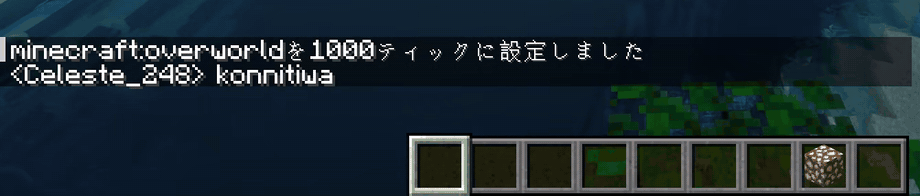
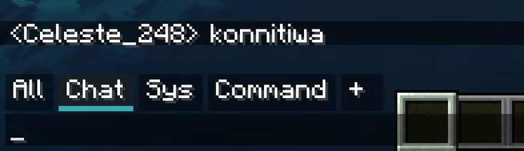

# Chataber

[English](README.md) · 日本語

[](https://github.com/Celesteria-154/Chataber/releases)
[](LICENSE.txt)
[](https://github.com/Celesteria-154/Chataber/releases/latest)
[](#対応バージョン)

Minecraftのチャットをタブで整理する、クライアント用Fabric Mod。

## プレビュー

**チャットの分類とタブ切り替え**



**`@here` の座標展開**



## 機能

- チャット、システムメッセージ、コマンドフィードバックの分類とタブ切り替え
- タブの追加、名前変更、並べ替え、表示カテゴリの設定
- DM相手ごとの会話表示、表示名、ピン留め、表示順の設定
- 未読バッジと左下のHUD通知。常時表示はタブ・DM相手ごとに設定可能
- `@here`を現在のブロック座標へ展開。出力形式を変更可能

## 設定と操作

Mod MenuからChataberの設定画面を開く。一般設定の「チャットタブ設定を開く」から、タブとDM相手を編集できる。

- `All`はすべての分類を表示する。各タブの「高度な設定」で表示対象を選択する。
- 「通知を常時表示する」は、編集中のタブまたはDM相手だけに適用される。`All`はHUD通知先ではないため設定対象外。
- 常時表示を無効にした対象には、一般設定のHUD表示時間を使用する。`0`で時間制限付き通知を無効にする。
- DM画面で通常の本文を入力すると、既定では`/tell {player}`形式で送信する。自動送信の無効化とコマンド形式の変更に対応する。
- プレイヤー名入力欄ではTab / Shift+Tabで候補を切り替え、Enterで確定する。
- 「Chataberタブ設定を開く」のキーは未割り当て。必要に応じてMinecraftの操作設定で割り当てる。

`@here`の既定出力は`X:{x} Y:{y} Z:{z}`。`{x}`、`{y}`、`{z}`を含む1行の形式へ変更できる。

## ビルド

```sh
./gradlew build # 既定は Minecraft 26.2 向け
./gradlew build -PmcVersion=26.1.2
./gradlew build -PmcVersion=26.3
./gradlew build -allVer
```
