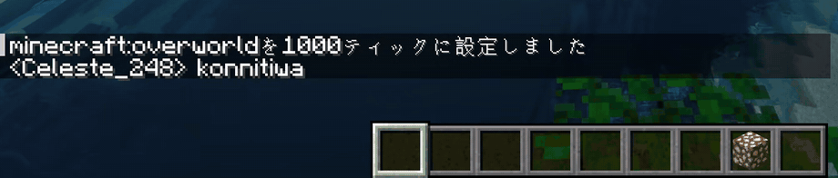
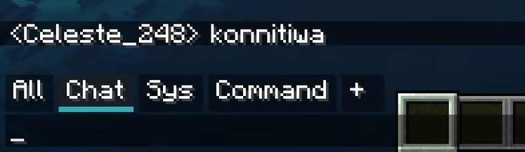

# Chataber


English · [日本語](README.ja.md)

[](https://github.com/Celesteria-154/Chataber/releases)
[](LICENSE.txt)
[](https://github.com/Celesteria-154/Chataber/releases/latest)
[](#supported-versions)

Chataber is a client-side Fabric mod that organizes Minecraft chat into tabs.

## Previews

**Filtering messages and switching tabs**



**Sharing coordinates with `@here`**



## Features

- Separate player chat, system messages, and command feedback into tabs.
- Add, rename, reorder, and configure the message categories for each tab.
- View direct-message conversations by player, set display names, pin contacts, and set their order.
- See unread badges and HUD notifications in the lower-left corner. Keep notifications visible per tab or DM contact.
- Use `@here` to share your current block coordinates in a configurable format.

## Settings and controls

Open Chataber in Mod Menu, then select **Open Chat Tab Settings** to manage tabs and DM contacts.

- `All` shows every message category. Select the categories for other tabs under **Advanced settings**.
- **Keep notifications visible** applies to the tab or DM contact you are editing. HUD notifications target individual tabs and contacts, so `All` has no setting.
- Timed notifications use the HUD duration in general settings. Set it to `0` to turn off timed notifications.
- Plain text in a DM view is sent using `/tell {player}` by default. You can turn off automatic DM sending or change the command format.
- Press Tab or Shift+Tab to cycle through player name suggestions, then press Enter to confirm.
- Assign the optional **Open Chataber tab settings** shortcut in Minecraft's controls menu.

The default `@here` format is `X:{x} Y:{y} Z:{z}`. You can use any single-line format containing `{x}`, `{y}`, and `{z}`.

## Build

```sh
./gradlew build # Defaults to Minecraft 26.2
./gradlew build -PmcVersion=26.1.2
./gradlew build -PmcVersion=26.3
./gradlew build -allVer
```
